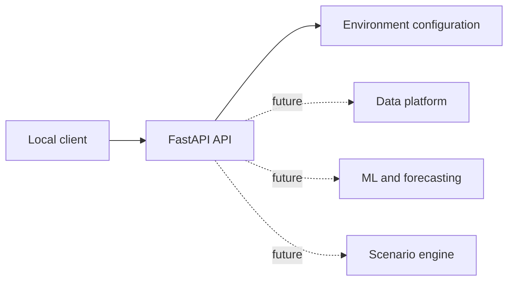

# CityPulse Architecture

## Phase 1 boundary

CityPulse starts as a Python monorepo with a small FastAPI service. The service is the stable boundary for later data, model, simulation, and dashboard capabilities.

## Planned evolution

- `ingestion/` will own source connectors and normalization.
- `preprocessing/` will own validation and feature creation.
- `geospatial/` will own city geometry and graph construction.
- `models/` will own training and inference code.
- `api/` will expose validated capabilities to the dashboard.
- `dashboard/` will remain a separate client boundary.

Phase 1 intentionally does not provision PostgreSQL, Kafka, Spark, or a frontend. Those services should be introduced when the corresponding data or interaction contract exists.
