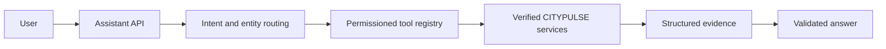

# Grounded Assistant Architecture

The assistant is a controlled interface, not an unrestricted chatbot.

The current checkout exposes only the verified health and system API. Domain tools are registered but return `unavailable` until their corresponding backend APIs exist. The assistant never substitutes fabricated values.
