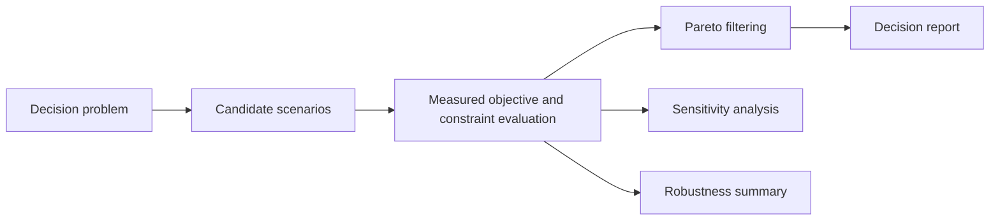

# Phase 12 Decision Engine

The decision layer evaluates explicit candidate metrics and preserves trade-offs. It does not choose a political outcome or declare a universal best option.

When simulation integration is available, candidates can carry Phase 11 scenario definitions. In this checkout, the scenario engine and decision engine are independently testable, but no real city-state data or risk engine exists for end-to-end urban optimization.
