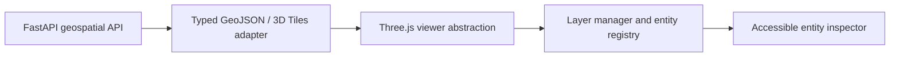

# Digital Twin Architecture

Phase 15 adds a reusable 3D visualization boundary over the existing frontend. The browser owns only UI state and rendering state; it does not access PostGIS, Redis, model files, or filesystem datasets.

The current backend exposes no geospatial API or WebSocket event stream, so the scene renders a non-geographic preview surface and shows `GEOMETRY UNAVAILABLE`. No city geometry is fabricated.
