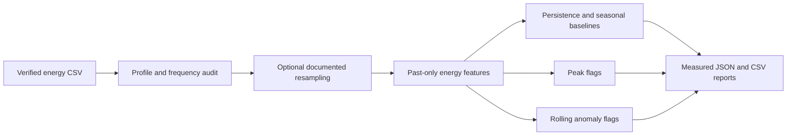

# Phase 8 Energy Architecture

The current repository does not contain a verified energy dataset or the Phase 6 deep-learning infrastructure. Phase 8 therefore establishes a source-agnostic energy contract and a runnable classical pipeline without fabricating a city, meter, load value, metric, or relationship.

## Data contract

Required columns are `timestamp` and one configured target, or one of `electricity_load`, `energy_consumption`, `power_demand`, `demand`, or `load`. Optional entity columns include `entity_id`, `zone_id`, `meter_id`, `building_id`, or `substation_id`.

Resampling is disabled unless `resample_frequency` is explicitly configured. Rolling features use `shift(1)` so they do not include the current or future demand value.

## Not yet measured

Dataset provenance, coverage, frequency, model comparison, weather alignment, deep-learning forecasts, traffic-energy relationships, and database predictions remain `NOT MEASURED` until a legitimate dataset and the missing earlier-phase infrastructure are available.
