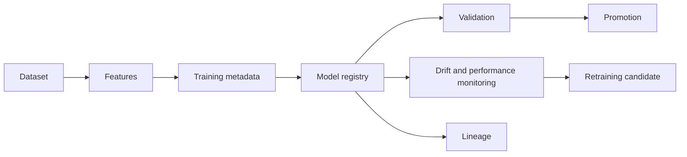

# MLOps Architecture

The repository currently has no trained model artifacts, MLflow service, or production database. Phase 17 adds a local JSON compatibility layer with the same lifecycle boundaries needed for later PostgreSQL/MLflow integration.

No model is registered automatically. No model is promoted automatically. Missing metrics, artifacts, labels, or thresholds remain explicit unavailable states.
