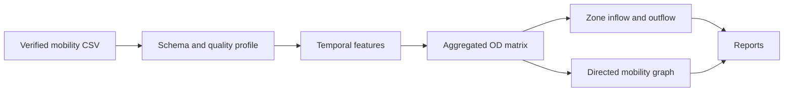

# Phase 9 Mobility Architecture

The mobility layer keeps aggregated movement separate from the road graph. Input records are validated, time-bucketed, and aggregated into OD flows. Zone inflow, outflow, and net flow are calculated from those observed aggregates.

No individual trip is emitted by the OD output. A mobility graph edge represents an observed aggregated flow and must not be interpreted as a causal relationship.
