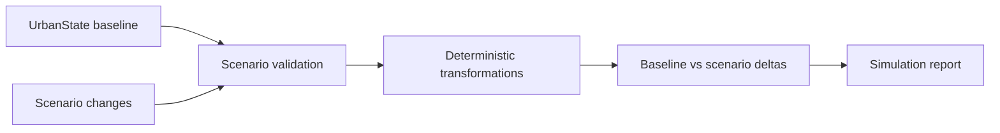

# Phase 11 Simulation Architecture

The simulation engine applies deterministic, validated transformations to an explicit `UrbanState` copy. It never mutates the baseline state.

Supported transformations include demand multipliers, energy multipliers, weather perturbations, road closures, lane reductions, hypothetical road additions, and transit change records.

The current implementation does not run microscopic traffic simulation, real routing, model inference, risk recalculation, database persistence, or uncertainty estimation because those earlier-phase artifacts are absent from this checkout.
