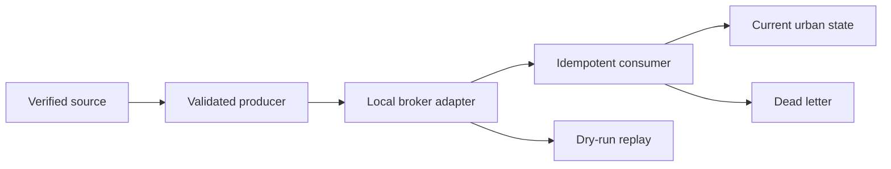

# Phase 18 Streaming Architecture

The selected development broker is a local append-only file compatibility adapter. It preserves the event contract and at-least-once processing shape without claiming Kafka, Redpanda, Redis, or cloud connectivity.

Production migration can replace the broker adapter with Kafka/Redpanda. Event ordering is only per source/topic implementation; global ordering is not guaranteed.
